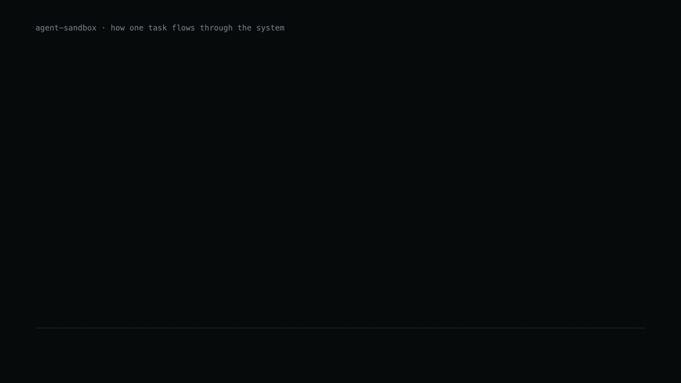
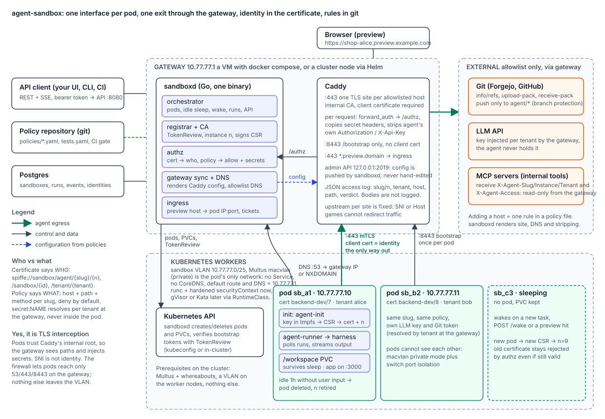

# agent-sandbox

Run coding agents in isolated Kubernetes pods: one network interface per pod, an mTLS egress
gateway (Caddy) that enforces per-agent host+path policy and injects secrets, and one Go service
(`sandboxd`) that owns identities, sandboxes, runs, the preview proxy and the gateway's configuration.



[MP4 version](docs/motion/agent-sandbox.mp4)

<details><summary>Static architecture diagram</summary>



</details>

Policy-as-Code: `policies/*.yaml` is the single source of truth. From it sandboxd renders the
Caddy configuration (one TLS site per host, client-certificate check, header stripping), answers
DNS for exactly those names and decides every request. Nobody edits the gateway by hand. A policy
also says which tenants own the slug, so a tenant cannot borrow another agent's rights.

Everything is driven through one API: sandboxes, runs, previews, usage, trace, agent versions and
rollouts, with static tokens or OIDC. Several `sandboxd` replicas can share one Postgres.

```
cmd/sandboxd        control plane binary (+ `sandboxd policy validate|test|render`)
cmd/sandboxctl      CLI over the API: create, run, watch, say, cancel, sleep, wake, preview, rollout, version, apply, delete
examples/catalog/   a working EnvironmentProfile + AgentDefinition pair (YAML, same schema as the API)
cmd/agent-init      pod init container: key + CSR → Registrar → certificate, client-cert config
cmd/agent-runner    pod main process: long-polls runs, executes the harness, streams output
api/openapi.yaml    API spec (served at /openapi.yaml, Swagger UI at /docs)
policies/           egress policies per slug, tests.yaml (expectations), schema.json (editor validation)
deploy/gateway/     gateway VM: docker-compose, .env.example, setup-vm.sh (nftables), bootstrap Caddyfile
deploy/helm/        Helm chart: gateway on a cluster node (mode node) or cluster-side pieces only (mode external)
deploy/k8s/         the same, rendered to plain manifests for kubectl apply (-k)
deploy/ansible/     playbooks: cluster.yaml (manifests, Secret, node label, token) and gateway.yaml (the VM)
images/             Dockerfiles for sandboxd, the agent image, an optional Caddy build with a DNS module
internal/           policy, gateway (Caddy render/push, DNS), identity, ca, registrar, authz, orchestrator, kube, ingress, store, httpapi, oidc, secrets,
                    catalog (versioned AgentDefinitions / EnvironmentProfiles), mcpproxy
internal/integration  the gateway path end to end on a real Caddy (make integration)
```

## Install

Three ways to roll out, same result: Helm, `kubectl apply` on rendered manifests, or Ansible.
Two layouts, pick one.

**A. Gateway on a cluster node** (everything through Helm)

1. Cluster with [Multus](https://github.com/k8snetworkplumbingwg/multus-cni) and
   [whereabouts](https://github.com/k8snetworkplumbingwg/whereabouts); worker nodes and one
   gateway node have an interface in the sandbox VLAN. Label the gateway node
   `agent-sandbox.io/gateway=true`, give it `10.77.77.1` on that interface, apply
   `deploy/gateway/nftables.conf` there.
2. Secret `agent-sandbox-secrets` with `SANDBOXD_API_TOKEN`, `DATABASE_URL`, `PREVIEW_TICKET_KEY`.
3. `helm install agent-sandbox deploy/helm/agent-sandbox -f values.yaml` (images, VLAN interface, preview domain),
   or `kubectl apply -f deploy/k8s/secret.example.yaml && kubectl apply -k deploy/k8s`,
   or `ansible-playbook -i inventory.yaml playbooks/cluster.yaml` from `deploy/ansible`.

**B. Gateway VM** (cluster stays untouched except Multus)

1. Same cluster prerequisites; `helm install ... --set gateway.mode=external` creates the
   NetworkAttachmentDefinition, RBAC and a token for sandboxd.
2. On the VM: `deploy/gateway/setup-vm.sh`, `cp .env.example .env`, fill it,
   `docker compose --profile with-postgres up -d`. Or let Ansible do both steps:
   `ansible-playbook -i inventory.yaml playbooks/gateway.yaml`.

In both cases, adding an external service the agents may use is one rule in a policy file.

## Policy workflow

```sh
sandboxd policy validate policies                      # syntax, host inventory, upstream conflicts
sandboxd policy test policies -f policies/tests.yaml   # allow/deny expectations, exit 1 on failure
sandboxd policy render -config sandboxd.yaml           # the Caddyfile that will be pushed
```

`.forgejo/workflows/policies.yaml` (and the GitHub twin) run these on every pull request that
touches `policies/`. After merge, `helm upgrade` (or a `git pull` of the policies directory on the
VM) is enough: sandboxd reloads, re-renders and pushes the gateway configuration within seconds.

### Network isolation

The sandbox VLAN is shared by every pod and node, and macvlan `private` only separates pods on
the same node. Two layers keep pods from talking to each other across nodes: an init container
with `NET_ADMIN` installs nftables rules inside every pod (`kube.pod_firewall`, on by default)
that allow egress to the gateway on 53, 443 and 8443, accept new connections only from the
gateway (the preview proxy reaching the application port) and nothing else, and the main
container, which has no capabilities, cannot undo them; where the switch supports it, configure
the VLAN as an isolated private VLAN with the gateway port as the only promiscuous port. The
gateway host's own nftables rules protect the gateway, not pod-to-pod traffic.
`hack/test-netlock.py` proves the four directions on an isolated Docker network and runs in CI.
With a gVisor RuntimeClass the in-pod nftables rules do not apply (no netfilter in the sandboxed
kernel); there the switch-level isolation is the only layer.

### MCP: enforced, not advisory

A rule with `mcp:` sends the host through sandboxd's MCP proxy instead of straight to the
upstream. The destination is the policy's upstream for the host name Caddy validated by SNI;
nothing in the request can redirect it. The proxy parses the JSON-RPC body strictly (single
calls and batches, exact lower-case protocol keys, no duplicates, no trailing data; anything
ambiguous is refused): with `read_only: true`, `tools/call` passes only for tools matching the
`tools` globs (`["get_*", "search"]`), and `initialize`, `ping`, `tools/list`, `resources/read`,
`prompts/get` always pass; everything else is a 403 before the request leaves the gateway.
`X-Agent-Access: read-only` is still sent upstream as a hint, but the policy no longer depends
on the server honouring it.

### Ownership: which tenant may run which agent

```yaml
slug: netops
tenants: [netops, platform]   # "*" = every tenant; absent = open (or admin-only with policies_strict)
allow: ...
```

`POST /v1/sandboxes` with a slug the tenant does not own is 403, so are rollouts by that slug.
Two kinds of grant exist and both are enforced on every request and by the reconciler:

- a **policy grant**: the tenant owns the slug under the policy repository, and keeps its running
  agents exactly as long as that stays true. Dropping the tenant, emptying the list in strict
  mode or deleting the slug's file revokes at once: the gateway answers 403, the pod is stopped;
- an **admin grant**: the admin created a sandbox for a slug the tenant does not own. The decision
  is the admin's, recorded on the sandbox (`admin_grant`) and in the agent certificate, and it
  lasts while a policy still applies to the slug (its own file; in permissive mode the default). `policies_strict: true` turns the default around: a policy without
a `tenants` list is admin-only and a slug without a policy file is refused instead of falling back
to `default`.

### How the gateway is generated and tested

Caddy sorts directives in a fixed order, so every site is rendered as an explicit `route {}`: strip
what the agent sent in identity and injected headers, `forward_auth` to sandboxd, copy the verdict
headers (identity plus injected secrets) onto the request, proxy. `make integration` starts a real
`caddy` (from `PATH` or `CADDY_BIN`), pushes the rendered configuration through the admin API,
bootstraps an identity through the registrar site and checks injection, stripping, policy denial,
the agent API and identity retirement end to end. CI runs it for Caddy 2.8, 2.9 and 2.10 (the
configuration needs 2.8 or newer for `trust_pool inline`).

## Use it

Everything goes through the API (`/docs` for Swagger UI); `sandboxctl` wraps it:

```sh
export SANDBOXD_URL=https://gw.example.com:8080 SANDBOXD_TOKEN=...
sandboxctl create -name shop -slug backend-dev -owner alice -repo https://git.example.com/org/shop.git
sandboxctl run sb_1234 "add integration tests for the checkout flow"
sandboxctl watch sb_1234                 # live output, status changes, your own messages
sandboxctl say sb_1234 run_5678 "use pytest, not unittest"
sandboxctl preview sb_1234 -port 3000    # https://shop-alice.preview.example.com
sandboxctl sleep sb_1234                 # or wait an hour of silence
sandboxctl version                       # control plane build, agent versions, env version per slug
sandboxctl rollout -version canary -slug backend-dev -percent 10
```

### What happens when things break

The reconciler (leader replica, every `idle_check_every`) checks that every running sandbox still
has a live pod. A pod that was evicted, killed or crashed makes its run `failed` with the reason in
the run output and a `run.finished` event, retires the identity and puts the sandbox in `error`
with the reason; `wake` starts a fresh pod. A run marked running while its sandbox has no pod is
failed the same way. The runner retries `/finish` with backoff until the control plane
acknowledges it (the endpoint is idempotent), so a lost acknowledgement never leaves a run
running. Pod deletion is synchronous: sleep, wake and rollouts wait for Kubernetes to finish the
graceful termination before creating the next pod under the same name.

### The agent image

`images/agent/Dockerfile` ships Claude Code, git, nftables and the sandbox binaries; user 1000 is
`agent` (the base image's `node` user is removed). At pod start the `netlock` init container locks
the network, then `agent-init` bootstraps the identity: it trusts the gateway root that sandboxd
publishes into the `agent-sandbox-gateway-ca` ConfigMap (mounted into every pod), obtains the
certificate and writes the mTLS settings every tool reads (`GIT_SSL_*`, `CURL_HOME`,
`NODE_EXTRA_CA_CERTS`, `CLAUDE_CODE_CLIENT_CERT` / `CLAUDE_CODE_CLIENT_KEY`). The trust store is
rebuilt on every bootstrap attempt, so a root published after the pod started is picked up.
`agent-runner` clones `repo` into `/workspace/repo` once (the volume persists) and starts the
harness inside it; a checkout whose origin differs from the sandbox's `repo` is moved aside and
the right repository cloned, never silently reused.
`make smoke-image` runs the shipped image's pieces in Docker; CI builds both images on every PR.

### Talking to the agent, reaching its workspace

A sandbox is a conversation, not a one-shot task. `sandboxctl chat <sandbox>` replays what was
said and lets you keep talking: a message reaches the running harness as input (with Claude
Code's streaming input, `harness.input: stream-json`, the conversation stays open and the
agent answers each message in the same process), and when no run is active the next message
resumes the harness session in a new run (`resume_command` with `$SANDBOX_SESSION` and the
message in `$SANDBOX_RESUME_PROMPT`). `/attach <file>` uploads into `/workspace/uploads/` and tells
the agent; `/close` ends the open conversation cleanly. The transcript (`GET /messages`, SSE at
`/messages/stream`) is derived from the event stream: user turns, assistant text, tool calls,
run boundaries. Workspace access goes through the runner over the same mTLS channel:
`files` (tree), `cat` (read), `put` (upload), each confined to `/workspace`. See
[docs/chat-and-files.md](docs/chat-and-files.md).

### Agents and environments as versioned configuration

Two catalogue resources describe what runs, per tenant (the admin also keeps shared ones):

- **EnvironmentProfile**: image, harness command, model and its client settings, resources,
  workspace size, lifecycle defaults, runtime class, extra environment.
- **AgentDefinition**: the policy slug (ownership is checked), the environment (`name`, or
  `name@N` to pin a revision), the repository, the instructions, and connection names for step 4.

The same document is a YAML file for `sandboxctl apply -f` (one document, or several separated
by `---`, applied in order; anything after a single JSON document is an error) and a JSON body
for `PUT /v1/environments/{name}` and `PUT /v1/agents/{name}`; unknown fields are errors. Every
write appends a revision, `expected_revision` makes it conditional (409 on a stale base), history
is at `/revisions`. Revision numbers are never reused: `DELETE` marks the item deleted and keeps
its revisions as history (`deleted_at`), pinned references to them stop resolving, and a later
write under the same name continues the numbering, so `name@1` names one configuration forever.
A sandbox is created with `agent_ref` instead of a slug: it takes the policy, repository and
lifecycle defaults from the agent, the environment is rendered into a `launch` that stays on the
sandbox, and `agent_revision` / `environment_revision` say what it was built from. Every run
records the revisions it was claimed under. Changing a definition changes nothing that already
exists: new sandboxes get the new revisions, running ones keep theirs.

References are `name`, `name@N` or `shared/name[@N]`. Tenants see their own items and the shared
ones; another tenant's are not found. A bare name is resolved in the writer's scope first, then
among the shared items, and the agent stores it in the form it resolved to (`shared/base@1`), so
a tenant creating its own `base` later does not capture agents that meant the shared one. The
sandbox and its runs record `agent_ref` / `environment_ref` the same way.

A profile's `env` (and `model.env`) is the agent container's only: it never reaches the init
containers that lock the network and bootstrap the identity, and it cannot set a platform name
(`SANDBOX_*`, `GATEWAY_IP`, `REGISTRAR_URL`, `API_URL`, `CERT_DIR`, `HOME`, `HARNESS_CMD`,
`HARNESS_RESUME_CMD`, `GATEWAY_CA_FILE`: refused with 422) or shadow the operator's `agent.env`.
The model name and the instructions are exported by the platform (`SANDBOX_MODEL`,
`ANTHROPIC_MODEL`, `SANDBOX_INSTRUCTIONS`). Resources are Kubernetes quantities, positive, with
requests within limits. See `examples/catalog/` for a working pair of documents.

```sh
sandboxctl apply -f examples/catalog/environment-python.yaml
sandboxctl apply -f examples/catalog/agent-backend.yaml
sandboxctl create -name shop -owner alice -agent backend
sandboxctl revisions environment python-dev
```

### Connections, policy bindings and tenant settings

Three more versioned resources, each its own service and module (`internal/connections`,
`internal/bindings`, `internal/tenants`), share the catalogue's document shape, revisions and
history:

- **Connection** (`/v1/connections`, tenant-scoped, shared ones by the admin): an HTTP API or an
  MCP server (`type`, `host`) and the headers the gateway adds for agents that use it. For a host
  the policy repository does not serve, the connection is the whole egress rule (`upstream`,
  `paths`, `mcp` restrictions): the gateway gets a site, the DNS an answer and the MCP proxy a
  rule for it on the next sync, and only sandboxes carrying the connection pass. A tenant may
  declare such a host only when its settings list it; the admin's shared connections may name
  any host. See [docs/self-service.md](docs/self-service.md). A
  credential header must be a `secret:NAME` reference into the tenant's secrets provider; a
  literal value is refused (422) and never echoed. Agents list the connections they use
  (`connections:`); the reference is resolved when the agent is written and stored with its scope,
  and a sandbox created from the agent records them (`connections`). On every allowed request the
  gateway decision (forward_auth and the MCP proxy) adds the headers of the sandbox's connections
  for that host, resolved from the sandbox tenant's secrets, under the policy's own injections;
  the Caddy config strips and copies those header names, so an agent can neither pre-set nor keep
  one. The values appear in no response, history entry or trace. A deleted connection adds
  nothing; a reference that no longer resolves fails the request (502) rather than sending part.
- **PolicyBinding** (`/v1/bindings`, admin writes, tenants read their own): the admin grants a
  policy slug to a tenant at runtime, on top of the policy file's `tenants:` list, with an optional
  `expires_at` and per-slug `max_sandboxes` / `max_awake`. The guard every decision goes through
  (sandbox creation and wake, the gateway's forward_auth, the catalogue's policy check) combines
  the repository and the live bindings. Deleting or expiring a binding revokes the slug: the
  gateway denies the running agent at its next request, the reconciler stops its pod, wakes and
  new sandboxes answer 403; the binding stays in the history.
- **TenantSettings** (`/v1/tenants/{tenant}/settings`, admin writes): the tenant's `quota`
  (replacing the server defaults), the `environments` its agents may use (`name` for its own,
  `shared/name`) and the `hosts` it may reach through connections of its own (exact names or
  `*.suffix`). The environment allow-list is checked when an agent is written and again when a sandbox is
  created, so an agent written earlier does not keep an environment the tenant lost; a restricted
  tenant cannot create by bare slug either, since that path runs the server's default environment.

Bindings, settings and connections are decided on every request, so each replica keeps an
in-memory snapshot: refreshed at once by the replica that writes, every 5 s on the others.
Reloads are serialised, so a reload that started before a revocation can never reinstall the
revoked grant after it. `internal/app` assembles these services the one way sandboxd runs them
and the integration tests use the same assembly. See `examples/catalog/`.

### Self-service: nothing to edit in the cluster

A tenant is onboarded, connects an MCP server and launches an agent through the API alone: the
admin issues a key and writes the tenant's binding and settings (`hosts`), the tenant declares
its connections and agents, creates a sandbox and runs it. The pod learns the MCP endpoints of
its connections (`SANDBOX_MCP_SERVERS`; the runner turns them into a Claude Code `--mcp-config`).
The policy repository, the secrets provider and the chart stay the operator's and are never
touched on the way. The whole path, step by step: [docs/self-service.md](docs/self-service.md).

### Plan: a bundle checked as a whole, nothing written

`sandboxctl plan -f bundle.yaml` (`POST /v1/plan`, YAML stream or JSON) validates every document
of a bundle against the platform at once and reports what `apply` would change, without
changing anything. Documents may depend on each other (an agent may name the environment and the
connection the same bundle introduces); each is checked against the caller's authority (a tenant
plans only in its own scope and the kinds it may write), compared with the current revision into a
stable field diff (`spec.resources.cpu_limit: 2 -> 3`), and given the `expected_revision` apply must
find, and the `next_revision` the item will have afterwards (numbering continues past deleted
revisions; an unchanged document keeps its revision), so a reference pinned to a revision apply
will not produce is refused by the plan. A document's own `expected_revision` that no longer
matches is a conflict. The plan is deterministic for the same documents and state, lists
changes in apply order, and carries a `bundle` fingerprint of the documents. `internal/plan` runs the same validators the API runs on a
write, over a read-only overlay of the store. See `examples/catalog/bundle.yaml`.

### Apply: one transaction per step, continued by key

`sandboxctl apply -f bundle.yaml` plans the bundle and applies it through the controller
(`POST /v1/apply` with the plan's fingerprint). The fingerprint binds the plan to the state
(scope, actions, expected and next revisions): a bundle whose plan no longer matches is refused
with 409 and nothing is written. Each step writes its item revision and its own completion in one
transaction, guarded by the apply record's version, so a step is either applied and recorded or
neither, and two replicas cannot both commit it. The apply is created once per idempotency key
(`-key`, the `Idempotency-Key` header, else the fingerprint) and continued, never redone: the
same key with the same bundle returns the same apply and finishes it; another bundle under the
key is a conflict. A replica continuing an unfinished apply takes a lease first. Continuation
(`sandboxctl apply -resume <id>`, `POST /v1/applies/{id}/resume`) re-plans the stored documents
under the stored scope with its current rights: a pending step must still find the revision the
plan expected (noop steps too), an applied step must still be the latest revision, every document
must still validate; otherwise the apply stops with status `conflict` and says why, its steps
showing exactly what was applied. `sandboxctl applies` lists them. See `internal/apply`.

### Provenance, drift and rollback

Every revision an apply writes carries its `source`: the apply, the bundle fingerprint and, when
the bundle came from Git, the repository, ref, commit and path (`sandboxctl apply` detects them
and records the commit only when the applied bytes are what HEAD holds for the file; credentials
in a repository URL are stripped by the client and again by the server). A revision
written by hand through the API carries none. An item belongs to the apply that wrote its latest
revision; `GET /v1/drift` (`sandboxctl drift`, exit 3 when anything moved) lists the items an
apply wrote that were since changed by hand (with the field diff) or deleted. `POST /v1/rollback`
(`sandboxctl rollback -apply <id>`, `sandboxctl rollback environment py [-to N]`) restores what
an apply wrote, or one item to a revision, as a new plan and apply under the caller's current
rights: a revoked right is never restored (bindings and settings are skipped, an agent whose
policy the tenant lost fails the plan and nothing is written), a creation is not undone, and the
restored revision says what it rolled back. See [docs/gitops.md](docs/gitops.md).

A repository of bundles drives all of this through pull requests alone: `sandboxctl plan
-markdown` is the pull request comment, the merge applies with the commit's SHA, a scheduled
`drift -markdown` pages when the platform moved. Ready-made GitHub Actions and GitLab CI jobs
(`deploy/git/`) run `sandboxctl` from its own image (`make images`, target `sandboxctl`). Or the
platform reads the repository itself: a `GitRepository` registered through the API (URL, ref,
bundle paths, a credential by reference) is checked and synced on request, each bundle applied
through the same controller under a key of repository, commit and path, so no workflow is
installed per repository. With a `webhook_secret` the repository's own webhook drives it: a push
to the ref syncs, a pull or merge request gets its plan as a comment and a commit status, and
every delivery, plan and sync is an event on the tenant's stream. The scenario of one settings
change as one pull request, all three ways: [docs/git-adapters.md](docs/git-adapters.md).

### Agent versions and rollouts

Every sandbox reports `agent_version` (the agent image its pod runs), `env_version` (a fingerprint
of the policy content, harness command, image and pod environment it was started under) and, while
a rollout is pending, `desired_version`. `GET /v1/version` returns the control plane build, the
version catalogue and the current environment version per slug, so drift is one comparison away.

```yaml
agent:
  default: registry.example.com/agent-sandbox/agent:1.4.2
  versions:
    stable: registry.example.com/agent-sandbox/agent:1.4.2
    canary: registry.example.com/agent-sandbox/agent:1.5.0-rc1
```

Tenants name versions from the catalogue; the admin may pass any image reference.

```sh
sandboxctl rollout -version canary -slug backend-dev -percent 10   # canary: a stable 10% of the slug
sandboxctl rollout -version canary -slug backend-dev               # the rest, when the canary looks good
sandboxctl rollout -version stable -instance 42                    # one agent by its identity number
sandboxctl rollout -version stable -all -force                     # admin: everyone, now
```

Per sandbox the mode is `wake` (asleep: applied on the next wake), `now` (running and idle: the pod
is replaced, the identity retired and reissued), `deferred` (a run is in progress: applied when it
finishes) or, with `-force`, `forced`: the run is cancelled, the pod replaced and a resume run is
queued that carries the harness session id captured from the output stream (Claude Code
`session_id`, Codex `thread_id`). The runner continues it with `harness_resume_command`
(default `claude --resume`; for Codex `codex exec resume "$SANDBOX_SESSION" ...`). The workspace
volume keeps the harness's own session files, so the conversation goes on in the new pod. Every
decision is a `rollout` event in the trace; every run records the `agent_version` that executed it.

### High availability

`sandboxd` is stateless apart from Postgres. With `database_url` set and `ca.source: db` (the agent
CA and the gateway root shared through the database, so every replica's Caddy issues certificates
the pods trust) any number of replicas can run at once: every write is checked
against the record's `revision`, quota decisions happen under a tenant lock shared by all replicas,
the reconciler (idle sleep, expiry, deferred rollouts, refused deletes, pods a dead replica left
behind) runs on the replica holding the leadership lease, and events appended by one replica reach
the SSE clients of the others through `LISTEN/NOTIFY`. Each replica drives its own Caddy and DNS,
so in the node layout you label several gateway nodes and put a VIP or DNS round-robin in front
(`gateway.replicas` in the chart, which refuses more than one replica without `ca.source: db`).

### Authentication: tenant API keys, static tokens or OIDC

A tenant gets its credentials from the API, not from the server's configuration or a cluster
manifest. The admin issues the first key; from then on the tenant manages its own keys (a key
per pipeline, rotation on a schedule, immediate revocation of a leaked one):

```sh
sandboxctl keys create -tenant acme -name ci -ttl 720h   # admin: the secret (sbk_…) is printed once
sandboxctl keys list                                     # as acme: its keys, never their secrets
sandboxctl keys rotate key_3f2a9c1e7b04 -grace 1h        # a new secret now; the old one works for 1h more
sandboxctl keys revoke key_3f2a9c1e7b04                  # refused on the very next request, every replica
```

`POST/GET /v1/tenants/{tenant}/keys`, `GET/DELETE /v1/tenants/{tenant}/keys/{id}`,
`POST .../keys/{id}/rotate`. The store keeps the key's id and the SHA-256 of its secret; every
request looks the key up, so revocation needs no restart and no cache to expire. `api_keys.max_ttl`
caps the lifetime a key may be issued with; an expiring key bounds the sandboxes it creates like an
expiring OIDC token does. `GET /v1/whoami` shows `subject: key:<id>`.


```yaml
oidc:
  issuer: https://login.example.com/realms/platform
  client_id: sandboxd
  tenant_claim: groups
  tenant_prefix: "sandbox-tenant:"      # groups ["sandbox-tenant:acme"] → tenant acme
  admin_claim: roles
  admin_value: sandbox-admin
  ttl_from_token: true
```

A JWT from the issuer is verified against its JWKS (signature, issuer, audience, expiry) and mapped
to a tenant or the admin role; `GET /v1/whoami` shows the result. The token's expiry bounds the API
session and, with `ttl_from_token`, the sandboxes it creates: their `expires_at` is capped at the
token's expiry and the agent certificates issued inside them cannot outlive the sandbox. Static
`api_token` (the admin) and `api_tokens[]` keep working next to keys and OIDC.

### Bring your own key: tenant credentials through the API

A tenant's LLM key, MCP token or Git credential no longer has to be placed in the secrets
provider by the operator. `PUT /v1/credentials/{name}` (`sandboxctl credentials set <name>`,
value from stdin or `-file`) stores it encrypted under the server's `credentials.key`; `GET`
returns metadata only (version, a fingerprint of the value, who and when); `PUT` again replaces
it for the next request; `DELETE` takes it out of the resolution chain on the next request.
`secret:NAME` resolves from the tenant's own credential first, then a shared one of the same
name, then the operator's provider: after a removal the next request falls through to those,
and fails at the gateway (502, nothing partial) only when none carries the name. Without
`credentials.key` the routes answer 503 and the provider alone resolves references.

### Secrets: directory, Vault/OpenBao or Infisical

`secret:NAME` references in policies are resolved per tenant with a shared fallback, from a mounted
directory (`secrets_dir`), from HashiCorp Vault or OpenBao KV v2 (`secrets.provider: vault`, token
or Kubernetes auth) or from Infisical (`secrets.provider: infisical`, machine identity). Values are
cached for `cache_ttl` and only ever appear in the gateway's response to Caddy, never in a pod.

### API contract in short

- **Tokens.** `api_token` is the admin; `api_tokens[]` are tenant-scoped: creation forces the tenant,
  foreign sandboxes are 403, lists, usage and trace are filtered. With `oidc`, JWTs are accepted
  too. `GET /v1/whoami` tells which you hold and when it expires.
- **Ownership.** A slug outside the policy's `tenants` list is 403; a version outside the catalogue
  is 403 for tenants.
- **Revisions.** Every sandbox carries `revision`; writes are conditional on it, so two replicas
  (or two clients) never overwrite each other silently.
- **Errors** are `{error, code, request_id}` with a stable `code`; `X-Request-Id` is echoed and logged.
  Malformed query parameters are 400, never silently defaulted.
- **Paging.** `limit` + `after` on lists; `X-Next-Cursor` appears only when a next page exists and
  stays valid when its anchor row is deleted.
- **Idempotency.** `Idempotency-Key` on `POST /v1/sandboxes` and `POST .../runs`: the key is reserved
  before the request runs, so a CI retry after a timeout never creates a second sandbox or run, a
  concurrent repeat waits (409), and a reuse with another body is refused (422).
- **Lifecycle.** `ttl` on create or `PATCH` sets `expires_at`; the sweeper deletes expired sandboxes.
  `PATCH` also changes `idle_timeout`, `wake_on_preview`, `repo`. Per-tenant `quotas` cap
  `max_sandboxes` and `max_awake` (429 `quota_exceeded`).
- **Delete** is honest: 204 only when the cluster confirmed; otherwise 502 and the record stays
  `deleting` with the reason, retried by the sweeper or by your next DELETE.

## Accounting and trace

Every run keeps what the harness reported (tokens, cost, turns), every gateway decision lands in
the event log with the tenant and slug stamped on it, and pod uptime is derived from status
changes. All of it is queried through the API, scoped by tenant, agent slug, sandbox or run:

```sh
sandboxctl usage -tenant acme -since 720h -by slug      # GET /v1/usage?tenant=acme&since=720h&group_by=slug
sandboxctl usage -slug backend-dev -by day
sandboxctl trace -tenant acme -since 24h                # GET /v1/trace: runs, inputs, every egress allow/deny
sandboxctl trace -slug netops -type egress.deny -f      # follow refusals live
```

Runs and events are not deleted with the sandbox, so history stays billable. Model cost comes
from the harness (Claude Code's stream-json `result` line is understood; others print
`{"type":"usage",...}` lines or send a total with `/finish`); compute is `pod_seconds` priced with
`accounting.pod_hour_usd` in the config.

## Run locally (no Kubernetes)

```sh
make test           # unit tests
make integration    # the gateway on a real caddy (CADDY_BIN=... or caddy on PATH)
make dev            # fake runtime, in-memory store, API on 127.0.0.1:8080, token dev-token, DNS on 127.0.0.1:15353
SANDBOXD_TOKEN=dev-token go run ./cmd/sandboxctl create -name shop -slug backend-dev -owner alice
dig @127.0.0.1 -p 15353 git.example.com
open http://127.0.0.1:8080/docs
```

## License

Apache-2.0, see [LICENSE](LICENSE).

